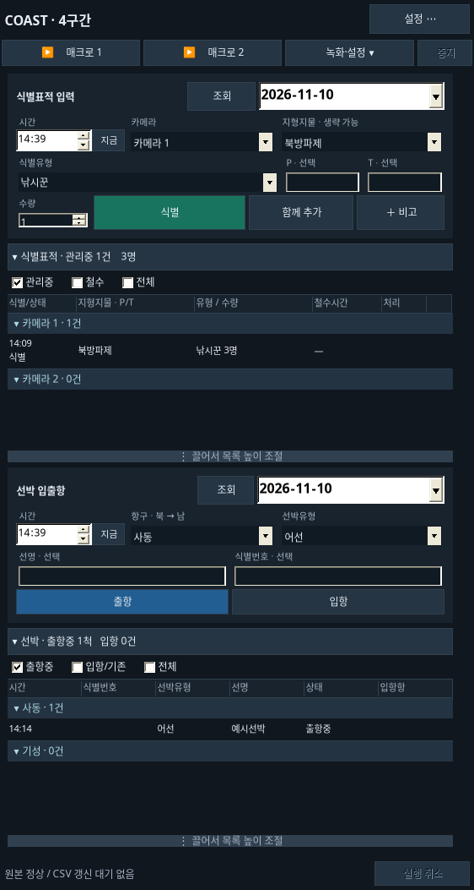
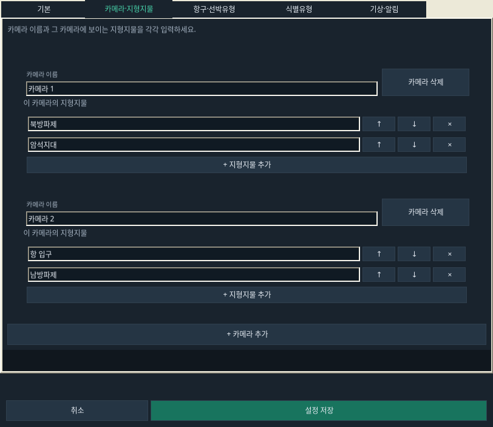
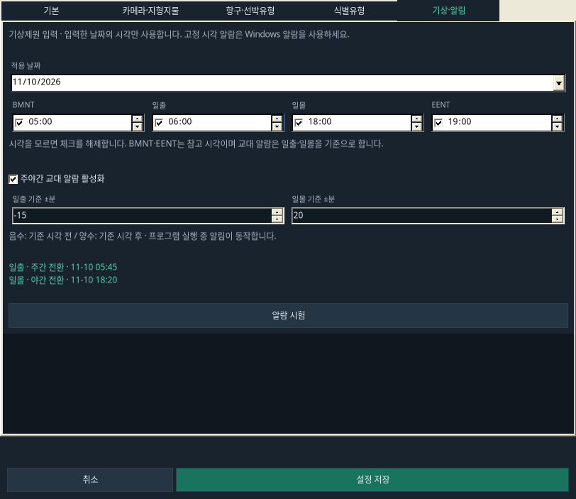
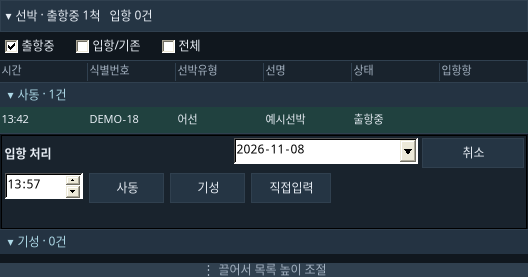
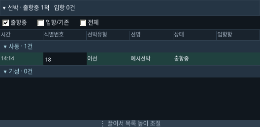
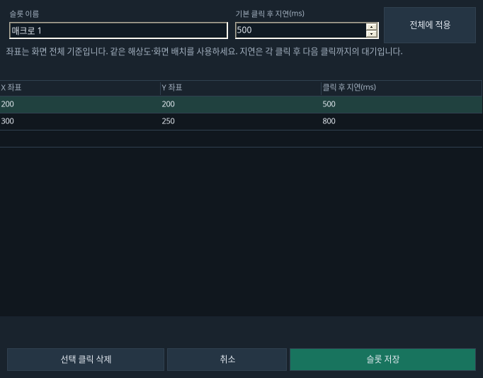

# log-support-system · COAST 기록 보조 프로그램

첨부한 HTML 목업을 참고하여 Windows Forms 화면과 클릭 동작을 변경했습니다.
기본 너비는 약 570픽셀이며 최소 420픽셀까지 줄일 수 있습니다.
화면은 **식별표적 입력 → 식별표적 목록 → 선박 입력 → 선박 목록** 순서입니다.
각 목록 아래 손잡이를 끌어 높이를 독립적으로 조절할 수 있습니다.



위 화면은 가상 데이터로 실행한 Linux/Mono 화면입니다. Windows의 테두리·글꼴·기본 컨트롤 모양은 다를 수 있습니다.
HTML 왼쪽의 CCTV 도형은 배치 설명용이므로 프로그램에 넣지 않았습니다.
COAST는 사람이 입력하는 기록·사진 관리 도구이며 영상·레이더를 연결하거나 자동 판단하지 않습니다.

## 이번 UI 개선

- 환경설정을 `기본`, `카메라·지형지물`, `항구·선박유형`, `식별유형`, `기상·알림` 탭으로 나눴습니다.
  카메라별 카드에서 이름과 지형지물을 따로 입력하고 추가·삭제합니다. 항구와 선박유형도 개별 입력칸과 순서 버튼을 사용합니다.
- 시간 옆 `지금` 버튼으로 현재 시각을 바로 적용합니다. 새 기록의 시각은 자동으로 갱신하며 수동 수정한 시각은 유지합니다.
  자정에는 새 입력 날짜가 자동으로 다음 날로 바뀝니다. 직접 선택한 과거 날짜와 수정 중인 기존 기록의 날짜는 보존합니다.
- 선박 목록의 식별번호 칸을 눌러 바로 입력합니다. Enter 또는 다른 칸으로 이동하면 저장하고 Esc로 취소합니다.
- 매크로 1·2의 재생 버튼을 상단에 항상 표시합니다. `녹화·설정`에서 슬롯별 녹화와 클릭 지연 편집을 엽니다.
- 기상 적용 날짜와 BMNT·일출·일몰·EENT를 입력합니다. 일출·일몰에 각각 ±분을 적용한 교대 알림을 제공합니다.
  BMNT·EENT는 참고 시각으로 보관합니다. 매일 바뀌는 시각은 사용자가 입력하며 자동 계산·다운로드하지 않습니다.

`공통 지형지물`은 이전 카메라명만 있는 설정을 읽기 위해 추가했던 공용 후보 목록입니다.
사용자가 요청한 기능이 아니었으며 이번 설정 화면에서 제거했습니다. 사용되던 기존 값은 해당 카메라의 지형지물로 옮겨 보존합니다.
이제 지형지물은 소속 카메라 카드 안에서만 편집합니다.





기존의 식별표적·선박 조회 및 CSV 분리, 목록별 높이 조절, 선박 우클릭 입항 처리도 유지합니다.
도구·우클릭 메뉴는 폼 종료 시 정리하여 메뉴 재사용 시 발생했던 `ContextMenuStrip` 오류를 방지합니다.



## 빌드와 첫 실행

1. `Program.cs`, `Core.cs`, `Dialogs.cs`, `MainForm.cs`, `Build.vbs`를 같은 쓰기 가능한 폴더에 둡니다.
2. Windows 10에서 `Build.vbs`를 실행합니다. .NET Framework의 `csc.exe`를 직접 실행하여 `CoastNotebook.exe`를 만듭니다.
3. 생성된 EXE를 실행하고 환경설정에서 구간명, CSV·사진 폴더, 카메라와 지형지물, 항구를 입력합니다.
4. 1~5구간은 PC마다 각자의 폴더와 데이터를 사용합니다. PC 사이의 자동 동기화·통합 기능은 없습니다.

C# 5 이하 문법, .NET Framework와 Windows Forms만 사용합니다.
PowerShell·외부 라이브러리·추가 설치 프로그램·인터넷 연결은 실행에 필요하지 않습니다.
빌드 실패 시 `Build.log`를 확인합니다. 컴파일 실패 시 이전 EXE는 교체하지 않습니다.
VBS는 기존처럼 `WScript.Shell.Exec`로 컴파일러를 직접 실행하며 `cmd.exe`를 경유하지 않습니다.

## 기존 데이터로 시험·업데이트

1. 기존 프로그램을 종료하고 프로그램 폴더 전체(Data 포함)를 다른 위치에 백업합니다.
2. 별도 시험 폴더에 새 소스를 넣고 빌드한 뒤 기존 `Data` 폴더의 사본을 넣습니다.
3. 기존 XML의 CSV·사진 경로는 예전 PC의 절대 경로일 수 있습니다. 시험용 출력 경로로 변경해 확인하세요.
   CSV는 설정된 폴더에 재생성됩니다. 연결 사진의 경로도 절대 경로이므로 실제 사진에 사진명 갱신을 실행하지 마세요.
4. 아래 Windows 확인 항목을 마친 후 각 구간에 적용합니다. 배포 ZIP에는 실제 `Records.xml`이 들어 있지 않습니다.

카메라별 설정·기상 시각·매크로를 보존하기 위해 저장 형식은 **5**입니다. 이전 형식 1·2·3·4를 읽고, 첫 저장 전에 원본 옆에
`Records.xml.v이전버전-날짜-고유값.bak`를 만든 후 업그레이드합니다.
이번에는 조회·CSV 분리까지만 적용하며 원본 XML은 기존 `Data/Records.xml` 한 파일을 유지합니다.
백업 실패 시 업그레이드도 중단합니다. 기록 ID·수량·사진 연결·설정·도움말을 보존합니다.
이전 EXE는 형식 5를 읽을 수 없습니다. 돌아가려면 새 데이터를 별도 보존한 뒤 업데이트 전 폴더 사본을 사용하세요.

이전 버전의 선박 입출항은 각각 독립 기록이었습니다. 그 출항이 실제로 입항했는지 추정하지 않습니다.
이전 선박 기록은 `출항(기존)`·`입항(기존)`으로 보존하고 `입항/기존` 또는 `전체` 필터에서 표시합니다.
필요하면 기존 출항의 우클릭 메뉴 `상태 되돌리기`로 사용자가 명시적으로 출항중 관리에 편입할 수 있습니다.
기존 선명/추적번호 공용 값은 선명 필드에 그대로 보존합니다. 새 식별번호를 임의로 추정하거나 분리하지 않습니다.

## 식별표적 입력

- 카메라를 선택하면 그 카메라의 지형지물 목록으로 바뀝니다. 지형지물은 생략하거나 직접 입력할 수 있습니다.
- 입력 제목 옆 날짜와 시간 입력란은 별개입니다. 표적의 날짜를 고쳐도 선박 입력의 날짜는 바뀌지 않습니다.
- 새 입력의 시간은 현재 시각을 따라갑니다. 시간 칸에 들어가거나 시각을 수정하면 수동 모드로 유지합니다.
  옆의 `지금`을 누르면 현재 시각을 적용하고 자동 갱신을 다시 켭니다. 선박 입력도 같습니다.
- 자정에는 새 기록의 날짜가 자동으로 바뀌며 작성 중인 비고·수량을 보존합니다.
  직접 선택한 과거 날짜와 기존 기록을 수정하는 동안에는 해당 날짜를 유지합니다.
- P는 방위각 0~6400, T는 고각 -180~180 정수입니다. 빈칸은 미입력, `0`은 실제 값 0입니다.
  소수·범위 밖 값은 저장하지 않습니다. 각도를 환산하지 않습니다.
- 펼쳐진 유형과 수량을 고르고 `식별`을 누르면 바로 한 건을 저장합니다.
  장바구니가 있으면 장바구니 항목들로 한 건을 저장합니다.
- `함께 추가`로 여러 항목을 모읍니다. 같은 묶음·하위항목은 0~999 범위에서 합산합니다.
  항목 칩을 누르면 해당 항목을 제외합니다. 칩 영역에 마우스를 올리면 묶음 합계를 확인할 수 있습니다.
- `＋ 비고`로 입력란을 열거나 접습니다. 입력란을 접어도 작성한 비고는 유지합니다.
- 저장에 성공하면 새 입력 상태로 돌아갑니다. 원본 저장 실패 시 작성 내용은 유지합니다.
- 목록의 기록을 누르면 `저장` 모드로 전환됩니다. 수정 후 저장하거나 `수정 취소`를 누릅니다.
  저장하지 않은 내용을 버리는 전환에는 확인창이 표시됩니다.
- 선택한 행의 `철수` 버튼은 현재 시각을 종료 시각으로 저장합니다. 편집 중인 변경 내용이 있으면 먼저 저장해야 합니다.
- 과거 기록도 열 수 있으며 날짜는 제목 옆 큰 날짜 입력란에서 확인·변경합니다.

## 선박 입출항

- 항구·선박유형·시각을 입력한 뒤 `출항`을 누릅니다. 선명과 식별번호는 각각 별도 필드이며 모두 생략 가능합니다.
- 출항중인 선박을 **우클릭 → 입항 처리**하면 그 행 바로 아래에 입항 입력 영역이 펼쳐집니다.
  시간과 날짜를 조절하고, 설정된 항구 버튼을 누르면 해당 항으로 입항 처리합니다.
  다른 항구는 `직접입력`을 눌러 이름을 적고 `입항 확정`을 누릅니다.
- **우클릭 → 빠른 입항**은 현재 시각과 해당 선박의 출항항으로 즉시 처리합니다.
- 같은 기록 ID에 입항 시각·입항항을 연결하며, 출항 시각·출항항은 바꾸지 않습니다.
  과거 입항 시각도 입력할 수 있지만 출항 이전이나 미래 시각은 거부하며 입력은 유지합니다.
- 선박 목록에는 처리·입항 버튼 열이 없고, 별도 입항항 열에 결과를 표시합니다.
- 위 입력 영역의 `입항` 버튼은 출항 이력이 없는 **단독 입항 기록**을 새로 만듭니다.
  자동으로 같은 선명·번호의 출항에 연결하지 않습니다.
- 연결을 잘못 처리했다면 `실행 취소` 또는 해당 출항 기록의 `상태 되돌리기`를 사용합니다.
  단독 입항 기록을 출항중으로 바꾸지는 않습니다.
- 선박 목록의 **식별번호 칸 클릭 → 번호 입력 → Enter**로 빠르게 번호를 저장합니다.
  다른 칸으로 이동해도 저장하며 Esc는 취소입니다. 저장 실패 시 입력을 보존하고 번호 칸에서 다시 시도할 수 있습니다.
  편집 중에는 목록 자동 갱신으로 입력이 지워지지 않습니다.
- 우클릭 `선박 정보 수정`으로 시각·항구·선박유형·선명·식별번호·비고를 고칠 수 있습니다.



## 목록·메뉴·실행 취소

- 식별표적·선박 목록은 기본적으로 **금일 식별/출항 기록**을 보여주며 관리중/출항중으로 필터링합니다.
  카메라·항구는 설정 순서를 따르고, 설정에 없는 과거 이름도 보존해서 표시합니다.
- 두 목록의 필터는 독립적입니다. 상태 둘을 함께 선택하면 `전체`로 정리하고,
  마지막 상태를 해제해도 `전체`가 선택되어 실수로 모든 상태가 사라지지 않습니다.
- 목록 제목을 눌러 각각 접거나 펼칩니다. 각 목록 아래 `끌어서 목록 높이 조절` 손잡이를 위아래로 움직입니다.
  목록 높이는 서로 독립적이며, 작은 화면이나 큰 목록에서는 전체 화면도 스크롤할 수 있습니다.
- 표적 행을 선택하면 철수와 `⋯` 버튼이 나타납니다. 선박은 우클릭 메뉴를 사용합니다. 다음 작업을 할 수 있습니다.
  기록 수정, 날짜·상태·비고 수정, 사진할당, 사진명 갱신, 보고문 확인·복사, 상태 되돌리기, 기록 삭제.
- 삭제는 확인 후 수행하며 사진 파일은 보존합니다.
- `실행 취소`는 **현재 실행 중 직전 기록 변경 한 번**을 되돌립니다. 등록·수정·철수·입항·삭제에 적용됩니다.
  나중에 변경된 도움말·설정·알림 확인 같은 기록 이외의 정보는 덮어쓰지 않습니다.
- 파일 경로와 기록의 불일치를 방지하기 위해 사진 처리나 설정 변경을 시작하면 실행 취소를 해제합니다.
  프로그램을 닫은 뒤 복원하는 변경 이력 기능은 아닙니다.
- 목록의 헤더 집계도 금일 식별/출항 시각 기준입니다. 전날부터 이어진 관리 건은 각 종류의 `조회`에서 확인합니다.

## 환경설정

상단 `설정 ⋯` → `환경설정`을 엽니다. 첨부 HTML의 환경설정 영역을 참고했습니다.

- `기본`: 구간명, CSV·사진 폴더, 보고문 복사와 저장 결과 팝업을 설정합니다. 폴더 직접 입력과 찾아보기를 모두 지원합니다.
  원본 XML은 EXE 옆 `Data/Records.xml`입니다.
- `카메라·지형지물`: 카메라 이름 한 칸과 그 카메라의 지형지물 목록으로 된 카드를 추가·삭제합니다.
  각 지형지물은 별도 입력칸이며 ↑ ↓로 순서를 바꿉니다. `|`나 쉼표로 항목을 나눠 입력할 필요가 없습니다.
- `항구·선박유형`: 각각 별도 목록으로 편집합니다. 항구는 북→남 순서로 배치하고 ↑ ↓로 순서를 바꿉니다.
- `식별유형`: 유형명·단위를 표의 별도 열에 입력합니다. 예: 유형명 `채집/해루질`, 단위 `명`.
  기록 화면에서는 `채집`, `해루질`을 따로 선택하며 묶음 합계도 유지합니다.
  이름·단위를 바꾸면 새 묶음 ID를 부여하고 과거 기록은 유지합니다.
- `기상·알림`: 적용 날짜와 BMNT·일출·일몰·EENT를 입력합니다. 모르는 시각은 체크를 해제합니다.
  교대 알림을 켜려면 일출·일몰을 모두 입력하세요. 각각 기준 ±분을 지정하고 계산된 알림 시각을 미리 확인합니다.
  음수는 기준 시각 전, 양수는 후입니다. 예를 들어 일몰 18:00, +20분은 18:20에 알립니다.
  BMNT·EENT는 참고 시각입니다. 고정 시각의 반복 알림은 제거했으며 Windows 알람을 사용합니다.
  기존 고정 일정은 더 이상 실행하지 않으며 설정을 저장하면 정리됩니다.

기상 알림은 입력한 날짜에만 적용되므로 다음 날의 시각은 새로 입력해야 합니다.
프로그램 실행 중 팝업·소리로 알리며 같은 알림은 한 번만 확인합니다. 오늘 이미 지난 알림은 미확인 상태라면 알립니다.
±분 때문에 자정을 넘는 알림은 실제 계산된 날짜를 따르며 이전 날짜의 지난 알림을 다음 날 반복하지 않습니다.
`알람 시험`으로 팝업과 소리를 확인할 수 있습니다.

`설정 ⋯` 메뉴에는 CSV 재시도, 열람용 CSV, 도움말 편집, 날짜 확인도 있습니다.

## 클릭 매크로 2개

1. 상단 `녹화·설정 ▾` → `매크로 1 녹화` 또는 `매크로 2 녹화`를 누릅니다.
2. 반투명 안내가 표시되면 원하는 위치를 왼쪽 클릭합니다. 화면 좌표와 클릭 간 실제 지연을 기록합니다.
   COAST의 매크로 버튼 줄 클릭은 녹화에서 제외하며, 최대 1,000개 클릭까지 저장합니다.
3. **Esc 또는 상단 `중지`**로 녹화를 마칩니다. 클릭·지연 편집 창에서 확인 후 `슬롯 저장`을 누릅니다.
   취소하면 기존 슬롯을 보존합니다. 슬롯 1과 2는 서로 독립적입니다.
4. 항상 보이는 `▶ 매크로 1`, `▶ 매크로 2`로 각각 한 번 재생합니다. 저장한 이름은 재생 버튼에 표시됩니다.
   빈 슬롯의 재생 버튼은 비활성입니다. 재생 중에도 Esc 또는 `중지`로 멈춥니다.
5. `녹화·설정` → 각 슬롯의 `편집·지연 설정`에서 X·Y 좌표와 클릭 후 지연을 고칩니다.
   기본 지연을 정하고 `전체에 적용`하면 모든 클릭에 적용합니다. 단위는 ms, 범위는 0~600,000입니다.



키보드 입력·드래그는 녹화하지 않습니다. 첫 클릭은 재생 시작 직후, 이후 클릭은 직전 클릭의 지연 후 실행합니다.
Windows 기본 API를 사용하며 설치 프로그램은 필요하지 않습니다. 녹화 당시의 해상도·모니터 배치를 사용해야 합니다.
화면 배치가 달라지거나 좌표가 화면 밖이면 재생을 중단하고 다시 녹화하도록 안내합니다.
매크로 실행 중에는 COAST의 기록 입력을 잠시 잠그고 완료·중지 후 다시 사용할 수 있습니다.

## 기록 조회·CSV·집계

- 식별표적·선박 제목 옆의 각 `조회`에서 시작일·종료일·검색어·상태로 조회합니다. 두 종류는 섞여 나오지 않습니다. 최근 1주, 전체 기간 버튼을 제공합니다.
- 조회 결과를 CSV로 저장하거나 유형별 묶음 합계와 하위항목별 집계를 볼 수 있습니다.
  수량은 기록에 등록한 수량의 합계이며 고유 인원수·실제 방문자 수가 아닙니다.
- 원본은 XML이고 CSV는 출력용입니다. 외부에서 수정한 CSV를 원본에 반영하지 않습니다.
- 날짜별 CSV는 `설정 폴더/연도/yyyy-MM-dd/Targets.csv`(식별표적), `Vessels.csv`(선박)로 각각 생성합니다.
  표적에는 수량·카메라·각도, 선박에는 출항항·입항항·선박 정보 등 각 종류의 열만 출력합니다.
  예전 혼합 `Records.csv`가 남아 있어도 더 이상 갱신하지 않습니다. 최신 파일은 위 두 파일입니다.
  다음 날 입항·철수한 기록도 시작 날짜 CSV의 종료 시각 열에 반영합니다.
- 각 종류에 맞는 항목과 시각을 별도 열로 출력하며 다른 종류의 기록이 포함되면 종류별 CSV 출력은 중단합니다.
  최초 등록구분이 출항인 기록도 입항 처리 후 상태는 입항이며 두 시각을 모두 보존합니다.
- 묶음 합계 열과 하위항목 수량 열을 모두 출력합니다. 두 종류를 함께 더하면 중복 집계됩니다.
  과거 묶음 기록의 세부 항목을 알 수 없으면 `미분류(기존 기록)`으로 남기며 임의 배분하지 않습니다.
- 원본을 먼저 저장하고 CSV를 갱신합니다. 실패한 날짜는 원본에 남겨 재시도합니다.
  날짜를 수정하면 이전 날짜·새 날짜를 모두 갱신합니다. 실행 취소도 관련 날짜를 다시 갱신합니다.
- `열람용 CSV`는 선택한 기록 날짜(없으면 오늘)의 사본을 기본 연결 프로그램으로 엽니다.
  한셀 연결은 실제 Windows에서 설정되어 있어야 합니다.

## 사진과 기존 기능

사진할당 창에서 사진을 선택하고 **실제 변경될 파일명을 미리 확인한 뒤** `할당`합니다.
복사와 SHA-256 검증, XML 연결 저장을 마친 다음 원래 파일을 삭제합니다.
삭제만 실패하면 두 파일이 남았다고 안내합니다. 충돌 시 기존 파일을 덮어쓰지 않습니다.

파일명은 기존 프로그램의 날짜·장소·내역·ID 규칙을 유지했습니다. 목업의 설명용 사진명과는 다르며,
실제 결과는 할당 창에 표시합니다. 한 장은 번호 없이, 여러 장은 `(1)`, `(2)`를 붙입니다.
사진 자동 삭제는 없으며 삭제된 사진은 연결 정보에 따라 파일 없음으로 표시합니다.
같은 데이터 폴더의 중복 실행 차단과 도움말 편집도 유지했습니다. 날짜 변경은 새 입력에 자동 반영합니다.

## 검증과 Windows 확인

Linux/Mono에서 C# 5 문법과 경고를 오류로 처리하여 컴파일했습니다.
자동 검증 158개가 통과했고, 실제 첨부 XML도 사본에서 읽기·업그레이드하여 기존 ID와 수량 보존을 확인했습니다.
`tests/Regression.cs`는 핵심 로직과 실제 WinForms 버튼·칩·행 처리·필터·설정을 검증합니다.
첨부 HTML도 Chromium에서 직접 클릭해 동작을 비교했습니다.
매크로는 가상 입력 장치로 녹화·지연·취소·슬롯 보존을 검증했습니다.
**Windows의 실제 클릭 전송·반투명 녹화창은 아직 확인하지 못했습니다.**
실제 Windows의 VBS·폴더 선택창·한셀·사진 이동 전체 흐름도 별도 확인이 필요합니다.

시험 폴더에서 다음 순서로 확인하세요.

1. `Build.vbs` 성공, EXE 실행과 창 위치·너비·입력 영역 스크롤.
2. 기존 XML 사본 열기, 첫 저장 전 형식 1/2/3/4 백업, 종료·재실행 후 데이터 유지.
3. 큰 날짜와 시간 분리, 카메라별 지형지물, 펼쳐진 채집·해루질 유형, P=3426/T=-121, 함께 추가·칩 삭제·수정 취소.
4. 선박 우클릭 → 입항 처리 → 행 아래 시간·항구 선택/직접입력, 과거 입항 시각, 빠른 입항, 단독 입항, 실행 취소.
5. 목록 순서·각 높이 조절·접기·펼치기, 두 조회의 데이터·CSV 분리, 메뉴를 여러 번 닫고 다시 실행해도 오류가 없는지 확인.
6. 시험용 사진의 한 장·여러 장 미리보기와 이동, 파일 충돌·원본 삭제 실패·사진명 갱신·파일 없음 표시.
7. 원본 저장 실패 시 입력 유지, CSV가 열려 갱신 실패한 경우 원본 보존과 CSV 재시도, 자정 날짜 자동 변경과 수동 입력 시각 유지.

8. 환경설정의 각 탭에서 카메라·지형지물 추가/삭제, 항구 순서 변경, 유형·단위 저장 후 재실행.
9. 기상 적용 날짜, 일출·일몰 ±분 미리보기·시험 알림·알림 확인 후 중복 방지.
10. 선박 식별번호 칸에서 Enter 저장·다른 칸 이동 저장·Esc 취소, 매크로 1/2 녹화·지연 수정·재생·Esc/중지.

개발용 테스트 실행 예(.NET Framework의 `csc.exe` 경로를 사용하고 `_build` 폴더를 먼저 만듭니다):

```bat
csc.exe /nologo /langversion:5 /warnaserror+ /target:exe /out:_build\Regression.exe /reference:System.Windows.Forms.dll /reference:System.Drawing.dll /reference:System.Xml.dll /reference:System.Core.dll Core.cs Dialogs.cs MainForm.cs tests\Regression.cs
_build\Regression.exe tests\legacy.xml --ui
```

테스트는 임시 폴더의 가상 데이터만 사용합니다. 배포 ZIP에는 실제 운용 데이터나 컴파일된 EXE를 넣지 않았습니다.
